<!--
Copyright (c) 2026 Omnira CJSC
Author: Tunjay Akbarli
Date: November 5, 2026

Functionality: Codira Programming Language
-->

# Codira Programming Language
### Stable Version: 26.11
### Build: November 5, 2026.

Release notes: [RELEASE_NOTES_26.11.md](RELEASE_NOTES_26.11.md)
(previous: [26.10](RELEASE_NOTES_26.10.md))

_Codira_ is an ahead-of-time compiled, statically typed language for high
performance systems, built around three ideas: the compiler proves what it
can about your code, a running program can be changed without restarting
it, and one source can target CPUs, GPUs, quantum processors and more.

## Features

- **Proven contracts** - `requires`, `ensures`, loop `invariant`/`decreases`,
  `ghost` state and refinement types are discharged by Z3 at compile time.
  A proven clause costs nothing at run time; a refuted one fails the build
  with a counterexample, which `codira test` can turn into a runnable test.

- **Synthesis** - `??` holes and `choose x where p` are filled only with
  expressions Z3 proves against the contract (`codira synth`).

- **Constant-time code** - `secret` values and `oblivious` functions: the
  compiler rejects any branch, index or loop bound that depends on a secret,
  and `ct_select` compiles to a select, never a branch.

- **Allocation-, panic- and block-free code** - `@noalloc`, `@nopanic`,
  `@noblock` and `@realtime` are proven over the whole call graph; a broken
  promise is reported with the chain of calls behind it.

- **Semantic envelopes** (experimental) - `@envelope(allocation: none,
  foreign: none, concurrency: none, secrecy: none, ..)` states what a
  function may do and is checked through its whole call graph;
  `codira envelope --json` reports every function's inferred envelope.
  Keys the compiler cannot check yet are rejected, not ignored.

- **Native storage and AI engines** (experimental) - `codira_db`: a
  write-ahead-logged, snapshot-isolation transactional store tested by
  crashing a workload at every storage operation; `codira_ai`: strided
  tensors, tape-based reverse-mode autodiff with every gradient rule checked
  numerically, attention and transformer layers, Adam/AdamW, INT8 weights
  and a BPE tokenizer. Programs reach the database and a first slice of the
  tensor engine through runtime services wrapped by `std/db` and
  `std/ai/runtime.code`. Limits and measurements:
  [`crates/codira_db/README.md`](crates/codira_db/README.md),
  [`crates/codira_ai/README.md`](crates/codira_ai/README.md).

- **Units of measure** - `f64 unit(m / s)` is checked at compile time and
  erased, so it costs nothing at run time.

- **Algebraic effects and structured concurrency** - `effect`, `perform`,
  `handle`, `resume`; `scope`, `spawn` and bounded channels on a worker pool,
  with every task joined before its scope ends.

- **First class hot reloading** - change code and data layouts of a live
  program. Objects survive layout changes (renamed fields with
  `@renamed(from:)`, retyped fields with defined conversions), and the whole
  GC heap can be saved and restored into another runtime.

- **A verifying optimizer** - Eidos optimizes with equality saturation and
  checks its transformations by translation validation; library authors can
  ship `@rewrite` rules that are proven before they are used.

- **Many targets from one source** - fourteen native targets held to LLVM's
  data layouts, standalone executables (`codira build --exe`), freestanding
  WebAssembly, NVIDIA GPUs (`@target(gpu)`, PTX), quantum kernels
  (`@target(qpu)`, QIR and OpenQASM), inline assembly (`@asm`), and a
  Cranelift backend that runs a program without LLVM or a linker
  (`codira run --jit`).

- **Interop** - C, C++ and assembly sources in a package, with C inlined into
  the Codira that calls it; `codira import-c` reads C headers through Clang;
  `codira bindgen` writes C, Rust, Go and TypeScript bindings; Bun imports a
  `.code` file directly.

- **Bounded execution** - fuel meters native code (`--fuel`), a runtime can
  cap its GC heap, and region arenas have byte quotas.

- **Tooling** - a language server, a build daemon that keeps the compiler
  warm, `codira test`, `codira query` (search by what code returns) and
  `codira quantum`.

What runs end to end today, and what is parsed but not yet compiled, is
listed precisely in [`agents/USING_CODIRA.md`](agents/USING_CODIRA.md)
("End-to-end status today"). Traits with static dispatch, standard-library
imports, semantic envelopes, `select`, session types and the native database
and tensor services are on `main`. Generic traits and trait objects, most
standard-library modules (still failing to check), proof-carrying
executables, and experimental hardware memory safety (ARM MTE is built but
never run on MTE hardware; CHERI targets are refused) are in progress.

## Compiler architecture

Each stage is a group of crates in `crates/`. Arrows into `codira_smt` (Z3)
and `codira_tv` are proofs the compiler asks for before it trusts a
contract, a transformation, a rewrite rule or a replacement instruction
sequence. This is the compiler as of 5 November 2026 (release 26.11): amber
outlines mark what was added or changed since 26.10, dashed outlines
mark parts that are on `main` but unfinished, experimental or opt-in, and the
grey box lists unfinished work that is not on `main`. Stage 8 works on
machine code: it reads the instructions the back ends produce.

```mermaid
flowchart TD
    %% ---------------------------------------------------------------- legend
    subgraph LEGEND [" Legend "]
        direction LR
        L1["on main before 16 Oct<br/>(plain outline)"]
        L2["added in 26.11<br/>16 Oct - 5 Nov (amber outline)"]
        L3["on main but unfinished,<br/>experimental or opt-in (dashed)"]
    end

    %% ---------------------------------------------------------------- 5
    subgraph TOOLS [" 5. Tooling and interop "]
        direction LR
        CLI["codira CLI<br/>new, build, check, run, start,<br/>test, query, synth, quantum"]
        Daemon["codira_compiler_daemon<br/>warm salsa + LLVM, token-authenticated"]
        LSP["codira_language_server"]
        ImportC["codira import-c<br/>C headers via Clang"]
        EnvCLI["codira envelope<br/>inferred envelope of every function,<br/>--json, --check"]
        Certify["codira certify<br/>re-checks proofs with Z3 alone,<br/>re-derives recorded envelopes"]
        ApiDiff["codira api-diff<br/>breaking-change check, Z3 implication,<br/>a widened envelope is major"]
        Attest["codira attest<br/>zero-knowledge proof of an oblivious function"]
        Ueval["codira_ueval<br/>evaluation harness scaffolding (paper)"]
    end
    TOOLS ==>|drive| FRONTEND

    %% ---------------------------------------------------------------- 1
    subgraph FRONTEND [" 1. Front end: codira_syntax, codira_hir (salsa) "]
        direction TB
        Src["Codira source<br/>*.code, codira.toml"] --> Parse["codira_syntax<br/>lexer, parser, lossless CST<br/>contextual keywords"]
        StdLib["std package<br/>import std.crypto.hash, std.fs.fs, std.memory.region,<br/>std.math.*, std.bit.*, std.complex, std.random.rng,<br/>std.base64, std.hashlib, std.time, std.sys.terminate,<br/>std.collections.optional; a ratchet test records<br/>which modules check clean, no implicit prelude"]
        StdLib --> Parse
        Parse --> ItemTree["Item tree and name resolution<br/>modules, visibility, imports,<br/>names across packages"]
        ItemTree --> Infer["Type inference<br/>generics, optionals, enums,<br/>closures, effect rows"]
        Infer --> Mono["codira_hir::mono<br/>one instance per type argument"]
        Traits["Traits and bounds<br/>trait, extend T: Trait, T: A + B,<br/>defaults, supertraits;<br/>static dispatch per instance"]
        Traits --> Mono
        Infer --- Traits
        Comptime["codira_comptime<br/>compile-time interpreter<br/>fuel + depth limits"] <-->|folds comptime blocks| Infer

        Enums["enum, match, optionals<br/>exhaustiveness checker"]
        Closures["function values and closures<br/>capture by value, hot-reload safe"]
        Loops["for loops, ranges, continue<br/>bounds-checked indexing"]
        Infer --- Enums
        Infer --- Closures
        Infer --- Loops

        subgraph CHECKS [" Static checks, every one a diagnostic, never a crash "]
            direction LR
            Effects["Effect obligations<br/>uses / handle"]
            Tasks["Structured concurrency<br/>scope, spawn, channels,<br/>select, session types"]
            Flow["Information flow<br/>secret, oblivious, ct_select"]
            Units["Units of measure<br/>f64 unit(m / s)"]
            Realtime["@noalloc @nopanic<br/>@noblock @realtime<br/>call-graph fixpoint over 8 effects,<br/>uses proven divisions"]
            Envelope["Semantic envelopes<br/>@envelope(allocation: none, ...)<br/>package envelope in codira.toml;<br/>unchecked keys rejected"]
            Codegen_ok["Codegen support<br/>honest refusals"]
            Bindings["Binding rules<br/>assigning to a let, in-place parameters<br/>and module-level let/var are errors"]
            Realtime --> Envelope
        end
        Infer --> CHECKS

        subgraph VERIFY [" Contract verification: codira_hir::verify "]
            direction LR
            Contracts["requires / ensures<br/>invariant / decreases / ghost<br/>refinement types, bit-exact,<br/>for and continue modelled"]
            Synth["?? holes and choose x where p"]
            TestGen["Counterexample to test<br/>codira test, codira query"]
        end
        Infer --> VERIFY
    end

    SMT["codira_smt<br/>Z3, deterministic rlimit"]
    VERIFY <==>|bit-vector proof obligations| SMT
    CERT["codira_certificate<br/>codira-certificate/2: proofs as SMT-LIB2,<br/>code hashes, inferred envelopes"]
    VERIFY --> CERT
    Envelope --> CERT
    CERT <--> SMT

    %% ---------------------------------------------------------------- 2
    subgraph EIDOS [" 2. Eidos mid-end: codira_mir, codira_egraph, codira_tv "]
        direction TB
        MirLower["mir_lower<br/>HIR to region SSA"] --> MIR["Eidos MIR<br/>typed region SSA, memory states"]
        MIR --> Passes["MIR passes<br/>const_fold, cse, dce, inline,<br/>unroll, simplify, rewrite"]
        Passes --> EGraph["codira_egraph<br/>equality saturation<br/>hard node cap, exact extractor"]
        Rewrite["@rewrite rules<br/>library equations"] -->|admitted only when proven| EGraph
        EGraph --> Fold["eidos_fold<br/>whole-function constant result,<br/>only for effect-free functions"]
        TV["codira_tv<br/>translation validation<br/>counterexamples re-executed"]
        Passes <==>|each transform checked| TV
        Rewrite <==>|proof before use| TV
    end
    Mono ==>|"--mode=release"| MirLower
    TV <==> SMT
    Realtime -.->|effect summary gates the fold| Fold

    %% ---------------------------------------------------------------- 3
    subgraph BACKENDS [" 3. Back ends: codira_codegen and friends "]
        direction TB
        LLVMGen["codira_codegen<br/>HIR instance to LLVM IR via inkwell<br/>bounds checks, effects, tasks, fuel,<br/>checked integer division, masked shifts,<br/>saturating float casts, value-struct host wrappers,<br/>array assignment, never-returning functions,<br/>ct_select stays a cmov at every -O level"]
        ArrayAlias["array alias classes<br/>TBAA tags for array lengths, elements, handles;<br/>opt-in, CODIRA_ARRAY_TBAA=1"]
        Targets["codira_target<br/>14 targets held to LLVM data layouts<br/>--target-cpu"]
        Native["[native] C, C++, asm in a package<br/>bitcode linked before optimization;<br/>C++ static constructors and destructors run<br/>(.init_array / .fini_array on ELF)"]
        Image["codira_image<br/>direct PE writer (default on Windows),<br/>ELF opt-in, declines what it cannot model"]
        LLD["codira_lld<br/>in-process LLD (fallback);<br/>macOS libraries ad-hoc signed by LLD"]
        Lib[".codiralib<br/>hot-reloadable shared library;<br/>imported std modules get their own"]
        Exe["codira build --exe<br/>standalone executable"]
        Wasm["wasm32-unknown-unknown<br/>module that imports nothing"]
        PTX["@target(gpu)<br/>NVPTX, launched by codira_gpu"]
        CL["codira_cranelift<br/>codira run --jit, no LLVM, no linker<br/>scalar core only; same integer, cast and<br/>print semantics as LLVM; narrow values<br/>extended across calls"]
        Quantum["codira_quantum<br/>@target(qpu): circuit IR, simulator,<br/>QIR, OpenQASM 2/3"]
        Circuits["codira_circuits<br/>oblivious function to R1CS, Circom,<br/>Groth16 (attest); Verilog (@target(fpga))"]
        Asm["@asm inline assembly<br/>machine memory intrinsics"]
        MTE["--sanitize=memtag (AArch64)<br/>experimental, never run on MTE hardware;<br/>CHERI / Morello targets refused"]
        Funis["funis_* crates (mold fork, MIT)<br/>ELF + Mach-O linker; library mode unfinished,<br/>not used by the compiler yet"]
        Bindgen["codira bindgen<br/>C, Rust, Go, TypeScript"]
        Bun["Bun plugin<br/>import a .code file"]

        LLVMGen --> Targets
        ArrayAlias -.-> LLVMGen
        Native --> LLVMGen
        Asm --> LLVMGen
        Targets --> Image
        Image --> Lib
        Targets -.->|"declined or other formats"| LLD
        LLD --> Lib
        LLD --> Exe
        Targets --> Wasm
        Targets -.-> MTE
        LLVMGen --> PTX
        Lib --> Bindgen
        Lib --> Bun
    end
    Mono ==> LLVMGen
    Fold -.->|constant shortcut| LLVMGen
    Mono ==>|dev JIT| CL
    Infer ==>|"qpu kernels"| Quantum
    Flow ==>|"oblivious subset"| Circuits

    %% ---------------------------------------------------------------- 4
    subgraph RUNTIME [" 4. Runtime: codira_runtime, codira_memory, codira_healing "]
        direction TB
        Loader["codira_libloader + codira_abi<br/>type info, GUIDs, dispatch table"]
        Reload["Hot reload<br/>relink dispatch table, migrate heap<br/>@renamed, saturating retypes;<br/>world stopped, only with no thread in Codira code"]
        Snap["Heap snapshots<br/>save and restore the whole GC heap"]
        Cells["Function-value code cells<br/>repointed on every reload"]
        GC["codira_memory<br/>mark-sweep GC, size-class blocks, heap cap;<br/>stop-the-world: every thread running Codira code<br/>parks at a safepoint, its stack scanned"]
        Regions["Region arenas with quotas<br/>W^X OS pages"]
        Pool["Worker pool<br/>scope joins, bounded channels"]
        EffRT["Effect handlers<br/>resume, abort across frames"]
        Fuel["Fuel metering<br/>--fuel"]
        Heracles["codira_healing (HERACLES)<br/>fault interception (Windows only),<br/>@heal strategies"]

        subgraph SERVICES [" Native services, extern C, generation-checked handles, negative error codes "]
            direction LR
            FsSvc["codira_fs_*<br/>open, read, write, seek,<br/>fsync, rename, sync_dir<br/>(std.fs.fs)"]
            HashSvc["codira_hash_*<br/>SHA-256, SHA-512, BLAKE3<br/>via sha2 / blake3 crates<br/>(std.crypto.hash)"]
            DbSvc["codira_db_*<br/>open, begin, get, put, delete,<br/>commit (conflict code), checkpoint<br/>(std/db/db.code)"]
            AiSvc["codira_ai_*<br/>f32 tensors, matmul, add, relu,<br/>softmax, Linear + MSE + SGD step<br/>(std/ai/runtime.code)"]
        end

        Loader --> Reload
        Reload --> GC
        Reload --> Snap
        Reload --> Cells
        Fuel --> Heracles
    end
    Lib ==> Loader
    Exe ==> Loader

    %% ---------------------------------------------------------------- engines
    subgraph ENGINES [" 6. Native engines (pure Rust, no Python, no BLAS) "]
        direction LR
        DbEngine["codira_db<br/>checksummed WAL, MVCC snapshot isolation<br/>(not serializable), atomic checkpoints,<br/>typed tables, add-column migrations;<br/>crash injected at every storage operation"]
        AiEngine["codira_ai<br/>strided tensors, broadcasting, blocked matmul,<br/>tape reverse-mode autodiff (gradient-checked),<br/>attention, transformer block, Adam/AdamW,<br/>INT8 weights, byte-level BPE"]
    end
    DbSvc ==> DbEngine
    AiSvc ==> AiEngine

    %% ---------------------------------------------------------------- quality
    subgraph QUALITY [" 7. Quality "]
        direction LR
        Diff["Differential testing<br/>seeded random programs on LLVM -O2,<br/>LLVM -O0 and Cranelift; outputs compared;<br/>every former divergence a regression test"]
        Bench["benches/ + scripts/bench.sh<br/>Criterion vs Rust, LuaJIT, Wasm;<br/>baselines recorded, not gated"]
        CI["CI on Linux, Windows and macOS<br/>Linux and Windows: all tests but a stale<br/>generated header pass (now regenerated);<br/>macOS: 23 more of 3,517 fail (Funis Mach-O, 6 codegen);<br/>nightly format check fails"]
        Supply["Supply chain<br/>cargo audit: 1 open advisory<br/>(tracing-subscriber via arkworks)"]
    end
    Diff -.->|checks| LLVMGen
    Diff -.->|checks| CL

    %% ---------------------------------------------------------------- 8
    subgraph MCODE [" 8. Machine code: codira_ctcheck, codira_mcode, codira_superopt "]
        direction TB
        CTCheck["codira_ctcheck<br/>codira build --check-constant-time:<br/>no secret branch, no variable-time instruction,<br/>no unchecked call, no secret address (x86-64);<br/>x86-64 and AArch64 machine code"]
        MCodeIR["codira_mcode<br/>x86-64 and AArch64 integer instructions,<br/>one semantics run concretely and as Z3 bit-vectors,<br/>checked against the CPU it runs on"]
        Profiles["cost profiles<br/>x86-64 latencies and throughputs measured<br/>on the host; AArch64 from the Neoverse N1<br/>optimization guide, never measured"]
        Superopt["codira_superopt<br/>codira build --superoptimize (experimental):<br/>the integer tail of each function, up to 3 instructions,<br/>proven equal by Z3, patched in place and re-proven;<br/>refuses constant-time code; cached"]
        MCodeIR --> Superopt
        Profiles --> Superopt
    end
    Lib -.->|"oblivious functions"| CTCheck
    Lib -.->|"--superoptimize"| Superopt
    Superopt <==>|"replacement proven"| SMT
    Flow -.->|"constant-time code refused"| Superopt

    %% ---------------------------------------------------------------- in progress
    subgraph NEXT [" Not on main: unfinished work "]
        direction LR
        N2["loop schedules (LLVM hints)<br/>fails a dependence-safety test"]
        N3["multi-shot continuations,<br/>sample / observe<br/>fails posterior checks"]
        N6["proof-gated live updates<br/>relational prover and runtime<br/>protocol do not compile yet"]
        N7["superoptimiser in loop bodies and on<br/>other targets, array handles marked<br/>dereferenceable"]
        N8["@budget, table declarations,<br/>tensor shape checking, memory<br/>domains, capability types (in progress)"]
    end

    classDef frontend fill:#1e293b,stroke:#38bdf8,color:#f8fafc,stroke-width:2px;
    classDef mid fill:#172554,stroke:#60a5fa,color:#f8fafc,stroke-width:2px;
    classDef backend fill:#064e3b,stroke:#34d399,color:#f8fafc,stroke-width:2px;
    classDef runtime fill:#3b0764,stroke:#c084fc,color:#f8fafc,stroke-width:2px;
    classDef tools fill:#422006,stroke:#fbbf24,color:#f8fafc,stroke-width:2px;
    classDef engines fill:#0c4a6e,stroke:#22d3ee,color:#f8fafc,stroke-width:2px;
    classDef quality fill:#1c1917,stroke:#a8a29e,color:#f8fafc,stroke-width:2px;
    classDef mcode fill:#3f1d1d,stroke:#f87171,color:#f8fafc,stroke-width:2px;
    classDef inner fill:#0f172a,stroke:#64748b,color:#f8fafc,stroke-width:1px;
    classDef smt fill:#581c87,stroke:#e879f9,color:#f8fafc,stroke-width:2px;
    classDef next fill:#1f2937,stroke:#9ca3af,color:#e5e7eb,stroke-width:1px,stroke-dasharray:5 5;
    classDef legend fill:#0f172a,stroke:#94a3b8,color:#f8fafc,stroke-width:1px;
    classDef added fill:#1f2937,stroke:#f59e0b,color:#fef3c7,stroke-width:3px;
    classDef wip fill:#111827,stroke:#9ca3af,color:#d1d5db,stroke-width:2px,stroke-dasharray:5 5;
    classDef old fill:#1f2937,stroke:#64748b,color:#f1f5f9,stroke-width:1px;

    class FRONTEND frontend;
    class EIDOS mid;
    class BACKENDS backend;
    class RUNTIME runtime;
    class TOOLS tools;
    class ENGINES engines;
    class QUALITY quality;
    class MCODE mcode;
    class CHECKS,VERIFY,SERVICES inner;
    class SMT,TV smt;
    class NEXT next;
    class LEGEND legend;
    class L1 old;
    class L2 added;
    class L3 wip;
    class N2,N3,N6,N7,N8 wip;
    class MTE,Funis,Ueval,ArrayAlias,Superopt,Profiles,CI wip;
    class StdLib,Traits,Tasks,Realtime,Envelope,EnvCLI,Certify,ApiDiff,CERT,Fold,LLVMGen,Lib,FsSvc,HashSvc,DbSvc,AiSvc,DbEngine,AiEngine,Diff,Bench,Heracles,Bindings,Native,CL,CTCheck,MCodeIR,GC,Reload,LLD,Supply added;
    linkStyle default stroke:#94a3b8,stroke-width:1.5px;
```



## Example

<!-- inline HTML is intentionally used to add the id. This allows retrieval of the HTML -->
<pre language="codira">
<code id="code-sample">// A contract the compiler proves with Z3: no runtime check is emitted.
func clamp(x: i64, lo: i64, hi: i64) -&gt; i64
    requires lo &lt;= hi
    ensures lo &lt;= result &amp;&amp; result &lt;= hi
{
    if x &lt; lo { lo } else if x &gt; hi { hi } else { x }
}

// Units of measure are checked at compile time and erased.
type Speed = f64 unit(m / s);

func speed(d: f64 unit(m), t: f64 unit(s)) -&gt; Speed {
    d / t
}

// Structured concurrency: every spawned task is joined before `scope` ends.
func square(jobs: Channel[i64], results: Channel[i64]) {
    let x = &lt;-jobs
    results &lt;- x * x
}

public func sum_of_squares(n: i64) -&gt; i64 {
    scope {
        let jobs = channel(64)
        let results = channel(64)
        for _ in 0..n { spawn square(jobs, results) }
        for i in 0..n { jobs &lt;- i }
        var sum = 0
        for _ in 0..n { sum += &lt;-results }
        sum
    }
}

// Proven allocation-, panic- and block-free, with bounded loops.
@realtime
func triangle(n: i64) -&gt; i64 {
    var total = 0
    for i in 0..n { total += i }
    total
}

public func main() -&gt; i64 {
    let v = speed(100.0, 8.0)
    clamp(sum_of_squares(10) + triangle(4), 0, 1000)
}</code>
</pre>


## Building from Source

Make sure you have the following dependencies installed on your machine:

* Rust (the version pinned in `rust-toolchain`; `rustup` picks it up
  automatically)
* LLVM 22.1 (a full dev distribution with `llvm-config` and the LLD static
  libraries). Codira reaches it through `llvm-sys` 221, so point
  `LLVM_SYS_221_PREFIX` at its install root, the directory whose `bin` holds
  `llvm-config`:
  * Debian/Ubuntu: `sudo bash scripts/install-llvm.sh` installs LLVM 22 from
    apt.llvm.org; then `export LLVM_SYS_221_PREFIX=/usr/lib/llvm-22`.
  * macOS: `brew install llvm@22`; then
    `export LLVM_SYS_221_PREFIX="$(brew --prefix llvm@22)"`.
  * Windows: extract the LLVM project's
    `clang+llvm-22.1.8-x86_64-pc-windows-msvc.tar.xz` release archive (for
    example to `C:\llvm22`) and set `LLVM_SYS_221_PREFIX` to that directory,
    or build LLVM 22.1 with MLIR and LLD from source with
    `pwsh build-llvm/build.ps1 -InstallDir C:\llvm22\built`.
* Z3 (`libz3` -- used by `codira_smt` for refinement-type checking and
  translation validation). Set `Z3_LIB_DIR` to the directory containing
  `libz3.so` (`libz3.lib` on Windows), or `Z3_ROOT` to a Z3 install prefix.
  On Debian/Ubuntu, `sudo apt install libz3-dev` puts it in the multiarch
  library directory, e.g. `/usr/lib/x86_64-linux-gnu`. On Windows,
  `choco install z3` needs neither variable: Chocolatey's install location is
  searched by default.

Clone the source code:

```bash
git clone https://github.com/theomnira/codira.git
cd codira
```

The doc tests in `crates/codira/tests/book.rs` are generated from the mdbook
in `book/`, which is not part of the repository. Without it the build prints a
warning and skips them.

Use `cargo` to build a release version

```bash
cargo build --release
```

## Language server

Codira contains support for the lsp protocol, start the executable using:

```bash
codira language-server
```

Alternatively, you can install editor-specific extensions.

## Funis

[`crates/funis*`](crates/funis/) is Codira's linker, forked from
[mold](https://github.com/rui314/mold) (MIT licensed, by Rui Ueyama) for the way
Codira links: a Codira library is a few kilobytes, so the cost is fixed overhead
rather than volume. It is part of the Codira workspace (`funis`, `funis_common`,
`funis_elf`, `funis_macho` and one crate per supported target) and keeps mold's
MIT licence; see [`crates/funis/README.md`](crates/funis/README.md) and
[`crates/funis/NOTICE`](crates/funis/NOTICE) for what it is, what has changed
from mold, and what is still only a goal.

## Strings: measured against Rust

`String` (see "Strings" in `agents/USING_CODIRA.md`) against Rust's
`String` on the same algorithms. The programs are in `benches/strings/`:
`src/mod.code` (Codira) and `strings.rs` (Rust), each printing one line per
benchmark with the elapsed nanoseconds and a check value; the check values
of the two programs are equal for every benchmark.

| benchmark | before String Fabric | Codira | Rust | Codira / Rust |
|---|---:|---:|---:|---:|
| `concat_1m_short`: 1M appends of `"word "` (`s += ..` / `push_str`) | 17.3 ms | 7.5 ms | 5.3 ms | 1.42x |
| `concat_1m_numbers`: 1M appends of `i.to_string()` and `"\n"` | 112.6 ms | 12.0 ms | 26.1 ms | 0.46x |
| `split_10mb_lines`: `lines()` of a 10.5 MB text (205,600 lines, views) | 10.3 ms | 6.5 ms | 5.7 ms | 1.15x |
| `lines_10mb_lazy`: `for line in text.lines()`, bytes summed | -- | 2.3 ms | 4.2 ms | 0.56x |
| `split_10mb_lazy_count`: `split(",").filter(len > 3).count()` | -- | 16.3 ms | 22.1 ms | 0.74x |
| `find_10mb`: `find("needle")` at the end of 10 MB of `"ab"` | 1.8 ms | 1.4 ms | 1.7 ms | 0.80x |
| `parse_1m_i64`: `parse_i64()` of 1M decimal fields, summed | 11.5 ms | 6.8 ms | 6.5 ms | 1.05x |

Medians of 11 alternating runs, on one machine: Intel Xeon @ 2.10 GHz (4
vCPUs, AVX2 and AVX-512), 16 GB, Linux 6.18; Rust 1.97.1. The machine was
shared with other builds (load average 4 to 5), so single runs vary by up
to 30%. Codira: the program built with `codira build -O 3` and run by
`benches/strings/host` (the runtime in release mode, so its string
functions are optimized as in a release `codira`); Rust: `rustc -C
opt-level=3 strings.rs`. Both for the default x86-64 target. (Rust's lazy
split uses a `char` pattern, `split(',')`, its fastest.)

What the numbers say:

- **An append with room is inline**: a check of the buffer's owner word
  against the thread pointer, of the fill and of the room, a copy and a
  plain store of the fill (see "String Fabric" in `agents/USING_CODIRA.md`
  for why no atomic is needed). Most of what is left of the 1.4x is
  memory: nothing is collected during the run, so every buffer is fresh
  memory (Rust's time on 100 strings of 10,000 appends rises from 2.7 ms
  to 5.1 ms when its strings are leaked instead of freed; Codira's is
  6.5 ms), and each doubling copies into a new GC buffer, where Rust's
  `realloc` of a large block remaps pages.
- **Numbers are written into the destination** (`concat_1m_numbers`): the
  digits go into the string's buffer; Rust's `i.to_string()` allocates a
  temporary `String` first.
- **Lazy `lines()`/`split()`** find each piece with `memchr` and make a
  view; the eager `lines()` counts the lines, then fills the `[String]`.
- **Search and parsing** run Rust's own code (`str::find`, `i64::from_str`
  inside the runtime), so they are at parity.
- Not measured: memory use, and GC pause times while strings are built.

To run them:

```bash
codira build -O 3 --manifest-path benches/strings/codira.toml
cargo build --release --manifest-path benches/strings/host/Cargo.toml
benches/strings/host/target/release/string_bench_host benches/strings/target/mod.codiralib
rustc -C opt-level=3 -o /tmp/strings benches/strings/strings.rs && /tmp/strings
```

## Garbage collector: roots, safepoints and relocation

The collector (`src/gc/`) is a stop-the-world mark-sweep collector over
size-class blocks (`gc/heap.rs`). This note covers how it finds the roots
on thread stacks, where threads stop for it, and the experimental
relocation of sparse blocks.

### Precise stack roots

Code compiled through LLVM carries *frame records* (`codira_codegen`,
`src/gc_roots.rs` and `cpp/gc_roots.cpp`). A pass over the linked assembly
module, before its final optimization, gives every function that makes a
call that may reach a collection a record on its stack: on entry the
function links it into the thread's chain (`gc/frames.rs`), on every return
it unlinks it. Every value that may hold a reference and is live across
such a call (or is an argument of one: a stack argument lives in the
caller's outgoing-argument area) is stored into a spill word of the record
when it is defined,
and every stack slot that may hold a reference is listed in it. "May hold
a reference" is decided on the IR: a pointer (or an aggregate with one) is
a reference unless it provably points at a stack slot, a global or a
constant; integers count only when `ptrtoint` made them from a reference.
The record's address escapes into the chain, so the optimizer must keep the
spill words current at every call that may read memory -- exactly the
calls that can reach a collection.

At a collection the collector reads the records' slots precisely and
leaves the machine frames they describe (`[lo, hi - 64)`, x86-64 System V)
out of the conservative scan of the thread's stack. The 64 bytes at the
top of each frame stay in the conservative scan: that is where the
prologue saved the caller's callee-saved registers, which may belong to a
host frame. Everything else -- host frames, foreign frames, code compiled
without records (the Cranelift JIT, a library built with
`CODIRA_GC_FRAMES=0`), and functions the pass could not handle -- is still
scanned conservatively.

Why this mechanism and not LLVM's statepoints or its shadow stack:

- **Statepoints** (`gc.statepoint`, `RewriteStatepointsForGC`) need every
  reference in a separate address space all the way through code
  generation, and the code generator uses one untyped `ptr` for references,
  payload pointers and raw addresses alike, passes references to the
  runtime through stack out-slots (which the rewrite does not track), and
  keeps references inside first-class aggregates (enums, strings). The pass
  here works on the IR as it is and treats out-slots and aggregates as
  regions.
- **LLVM's shadow-stack strategy** keeps its chain in one global (not per
  thread) and needs `gcroot` annotations emitted for every reference.
- Both would leave the Cranelift JIT out; the record format is a plain
  interface any back end can produce (see `codira_codegen::gc_roots`).

The cost is per function, not per loop iteration: one indirect call to get
the chain head, a handful of stores on entry and one on return, plus one
store per spilled value at its definition.

Selection: `CODIRA_GC_ROOTS=conservative` (or
`frames::set_root_mode(RootMode::Conservative)`) scans every stack word
conservatively again, records included -- a fallback that cannot be wrong
about compiled frames. Precise is the default.

What precise scanning does *not* do: an integer that sits in a
callee-saved register at the safepoint still retains the object it points
into (those registers may hold a host frame's references). The test
`precise_roots::integers_that_look_like_pointers_do_not_retain_objects`
holds 40 such integers across a collection: 6 objects (the six
callee-saved registers) are retained, against all 40 with the
conservative scan.

### Safepoints

- Every allocation (as before), and every call into the runtime that
  allocates.
- **Polls**, inserted after the final optimization so they never block
  vectorization: on the back-edge of every loop whose trip count scalar
  evolution cannot bound when the loop is entered, and at the entry of
  every function that makes a call (which every recursion goes through).
  A poll is a load of the poll word and a branch to a cold call. A loop
  the optimizer can bound (counted loops, loops over arrays and ranges,
  loops that may also exit early) is not polled: a collection may wait for
  it to finish. A thread parked at a poll is scanned conservatively: the
  optimizer ran before the poll existed, so the spill words need not be
  current there.
- **Blocking regions** (`safepoint::blocking`): channel operations, joins,
  sleeps. The thread is parked for their duration.
- **Foreign calls**: a call to an `extern` function declared `@noalloc`
  (a trusted assertion that it neither allocates nor calls back into
  Codira code) is bracketed by `codira.gc.foreign_enter` /
  `foreign_leave`: the thread is parked while the foreign code runs, its
  stack scanned from the stack pointer at the call, plus the callee-saved
  registers at the transition. A call to any other `extern` function keeps
  the thread running, as before.

`CODIRA_GC_STRESS=<n>` collects at every n-th safepoint of a thread (`1`:
every allocation and every poll).

### Relocation (experimental, off by default)

`MarkSweep::set_compaction(true)`, `RuntimeBuilder::compaction(true)` or
`CODIRA_GC_COMPACT=1`. After the sweep, the collector moves the live
objects out of size-class blocks that are at most a quarter full, into the
free cells of the class's other blocks, sparsest blocks first and only
while those cells can take them (so it never needs memory the heap does
not already hold, which is what lets it help at the heap limit), rewrites
every heap reference to a moved object, and releases the emptied blocks.

It is mostly-copying: an object that any stack refers to (precisely or
conservatively), a rooted object (`GcRuntime::root`, `GcRootPtr`,
`RootedStruct`) and a pinned one (`MarkSweep::pin`) never moves, so stack
slots and host-held handles are never rewritten. Blocks in which a
thread's allocation cache holds a run are left alone. Hot-reload migration
and heap snapshots run in their own stops and see a heap in which every
reference is current.

Measured with `relocation::fragmentation_*` (400,000 48-byte objects of
which every 16th is kept, then 60,000 160-byte objects, collecting after
each phase): the heap holds 29.7 MB without relocation and 11.7 MB with it;
under a 16 MiB heap limit the non-moving collector aborts in the second
phase and the relocating one finishes.

What keeps it experimental: it has run on x86-64 Linux only; the stacks
pin (a frame that refers to a sparse block's object keeps the block); and
host code that keeps a `GcPtr` it neither roots nor pins (in a Rust data
structure) was never safe across a collection and is now also wrong after
one.
